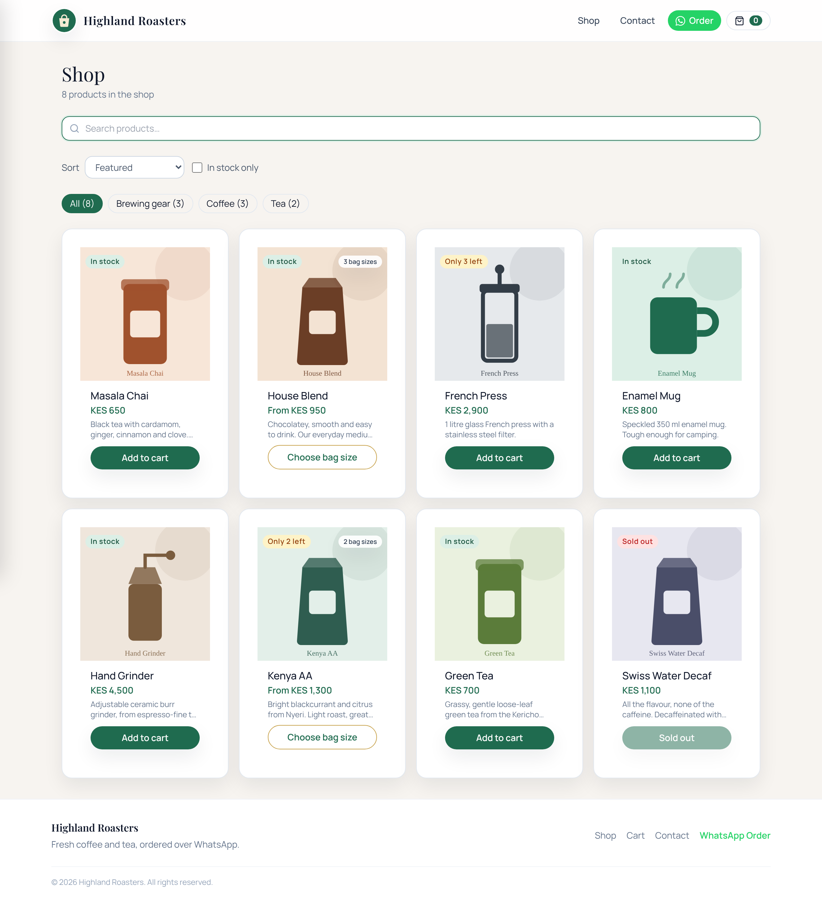
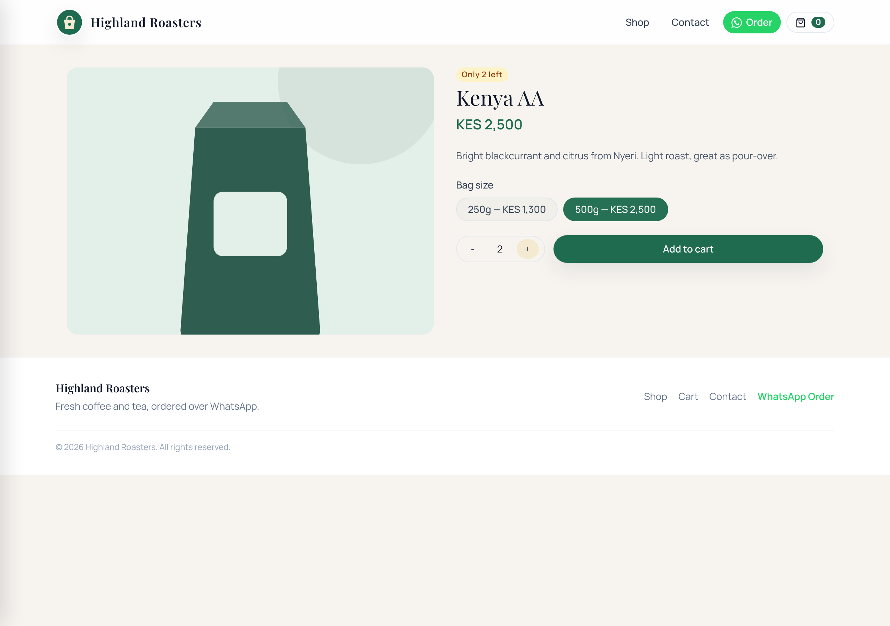
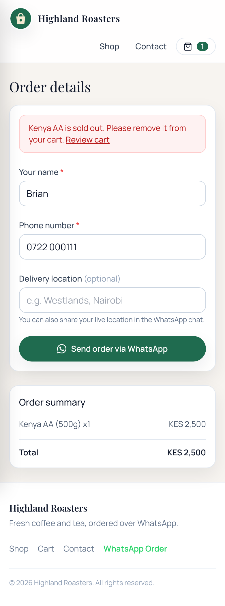
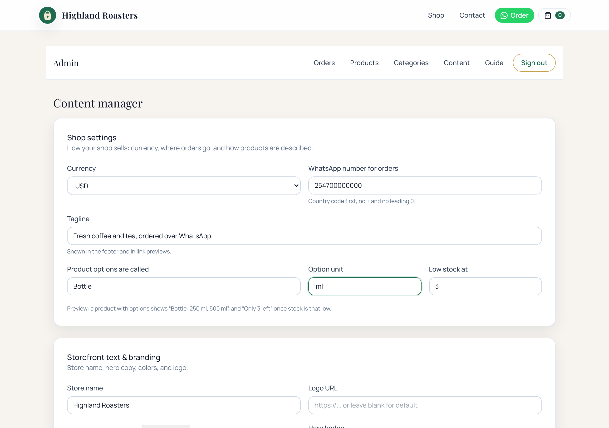
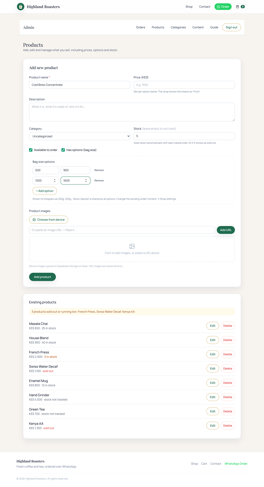
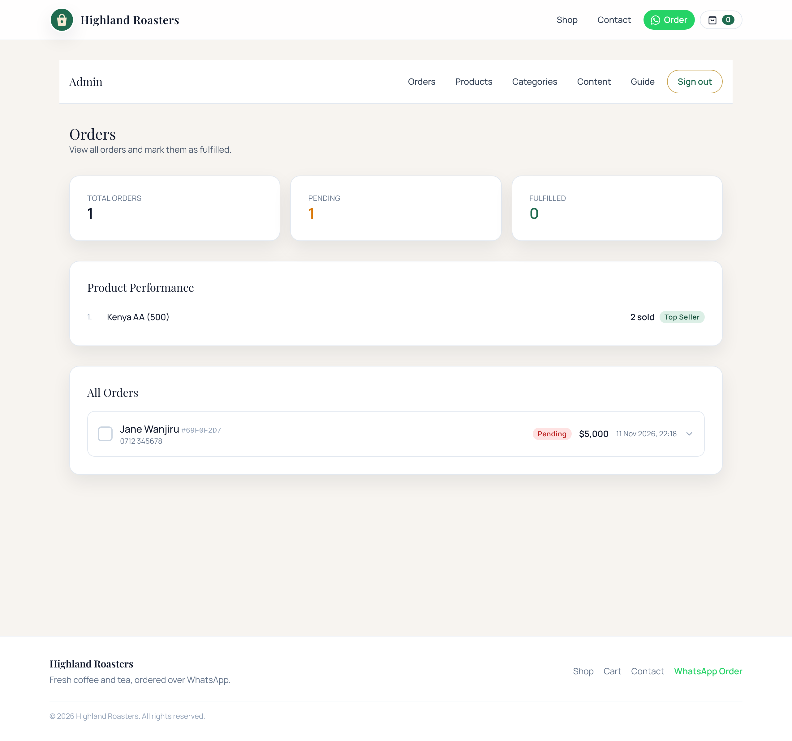

# WhatsApp Storefront


A small online shop where customers browse, fill a cart and send the order to you on WhatsApp.
One codebase works for any small business: set your shop name, currency, WhatsApp number,
colours and product options in the admin, and add your products. The demo data is a coffee shop.



## Features

**For shoppers**
- Browse by category, **search**, **sort** (featured, newest, price, name) and filter to **in stock only**
- Product pages with photo gallery and **options with their own price** (bag size, bottle size…)
- **Stock you can trust:** "Only 2 left" labels, sold-out items can't be added, and quantities are capped at what's in stock
- Cart saved in the browser; checkout opens WhatsApp with the full order and an **order reference**
- If stock ran out while they shopped, they're told before WhatsApp opens

**For the shop owner** (`/admin`)
- **Shop settings:** currency, WhatsApp number, tagline, what options are called and their unit, low-stock level
- Storefront text, brand colours and logo
- Products with photos (upload or URL), options, and a **stock count** that goes down with every order
- A restock warning listing products that are sold out or running low
- Categories, and an orders list with references and fulfilment status

| Product options | Sold out at checkout | Shop settings |
|---|---|---|
|  |  |  |

| Adding a product | Orders |
|---|---|
|  |  |

## Tech stack

- **Frontend:** Next.js 16 (App Router), React 18, TypeScript, Tailwind CSS, Zustand (cart)
- **Backend:** Supabase: PostgreSQL with row-level security, Auth (admin login), Storage (photos)
- **Ordering logic:** a PostgreSQL function (`place_order`) that prices orders and reserves stock

## How ordering works

1. The cart lives in the browser (localStorage). Prices shown there are for display only.
2. At checkout the browser calls `place_order(name, phone, location, items)`. That database function:
   - locks each product row, so two shoppers can't both buy the last item
   - checks it's available and that enough stock is left
   - takes the price from the `products` table (including the chosen option's price), never from the browser
   - lowers the stock and saves the order with the server-calculated total
3. Only then does WhatsApp open, with the order lines, the total and a short reference (the first 8
   characters of the order id) that also appears in the admin.

Shoppers can't insert into `orders` directly any more, so nobody can save an order with a made-up total.

## Security

- Row-level security on every table. Anyone can read products, categories and storefront text.
- **Admins are listed in the database** (`shop_admins`). Being signed in isn't enough: every admin
  write, the orders list and photo uploads check `is_shop_admin()`. A stranger who signs up through
  Supabase Auth can log in but can't change anything.
- Only the anon (public) key is used in the browser.

## Project structure

```
whatsapp-storefront/
├── src/
│   ├── app/              # Pages: home, shop, product, cart, order, contact, admin/*
│   ├── components/       # Shop UI, ShopProvider (settings + money formatting), admin forms
│   └── lib/              # cart store, stock rules, settings defaults/validation, WhatsApp message, Supabase clients
├── supabase/
│   ├── setup.sql         # Tables, RLS, admin list, place_order(), storage bucket. Safe to re-run.
│   └── seed.sql          # Demo coffee shop (optional)
├── public/demo/          # Illustrations used by the demo products
└── middleware.ts         # Sends signed-out visitors from /admin to the login page
```

## Run it locally

You need Node.js 20+ and a Supabase project. Either use a free project at supabase.com (nothing
gets hosted, it's just the database), or run Supabase on your machine with
[Docker Desktop](https://www.docker.com/products/docker-desktop/) and `npx supabase start`.

1. **Database.** In the Supabase SQL editor (or `psql`), run `supabase/setup.sql`, then optionally
   `supabase/seed.sql` for the demo products.
2. **Admin account.** In Supabase go to Authentication → Users → Add user and create your login.
   Then allow it into the admin:
   ```sql
   insert into public.shop_admins (email) values ('you@example.com');
   ```
3. **App.**
   ```powershell
   npm install
   Copy-Item .env.example .env.local   # paste your Supabase URL and anon key
   npm run dev
   ```
4. Open http://localhost:3000 for the shop and http://localhost:3000/admin for the dashboard. Set your
   WhatsApp number under **Content → Shop settings** before taking orders.

### Upgrading an existing database

`setup.sql` only adds what's missing (new columns, the admin list, `place_order`) and replaces the
policies, so you can run it again on a database created by an older version. Afterwards, add your
email to `shop_admins`, or the admin will refuse you.

## Limitations

- WhatsApp is the "payment" step: there's no online payment, and the shop confirms orders by chat.
- With `NEXT_PUBLIC_SAVE_ORDERS=false`, orders aren't saved and stock isn't reduced.
- Stock is shared by all of a product's options (one count for every bag size).
- If a shopper's connection drops just after `place_order` succeeds, the stock is taken but WhatsApp
  doesn't open. The order still appears in the admin, so the shop can follow up.
- Changing the currency changes the label, not the stored prices.

## Future improvements

- M-Pesa (Daraja STK push) payment before the WhatsApp step
- Per-option stock counts
- Order status updates sent back to the customer on WhatsApp
- Discount codes

## License

MIT, see [LICENSE](LICENSE).
